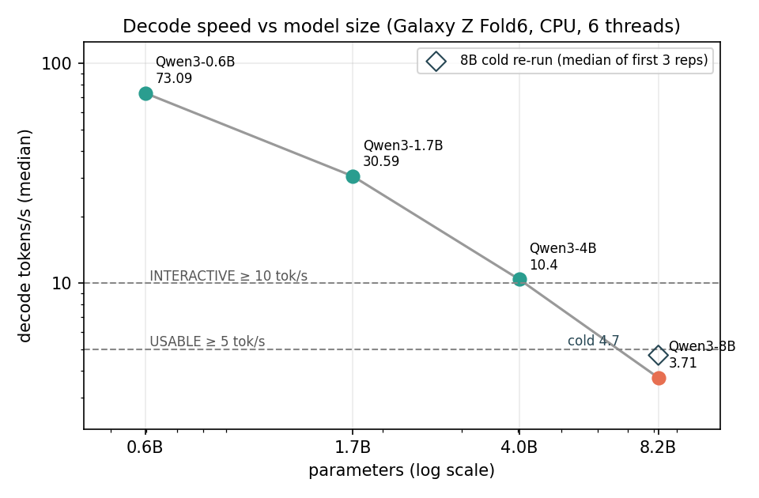
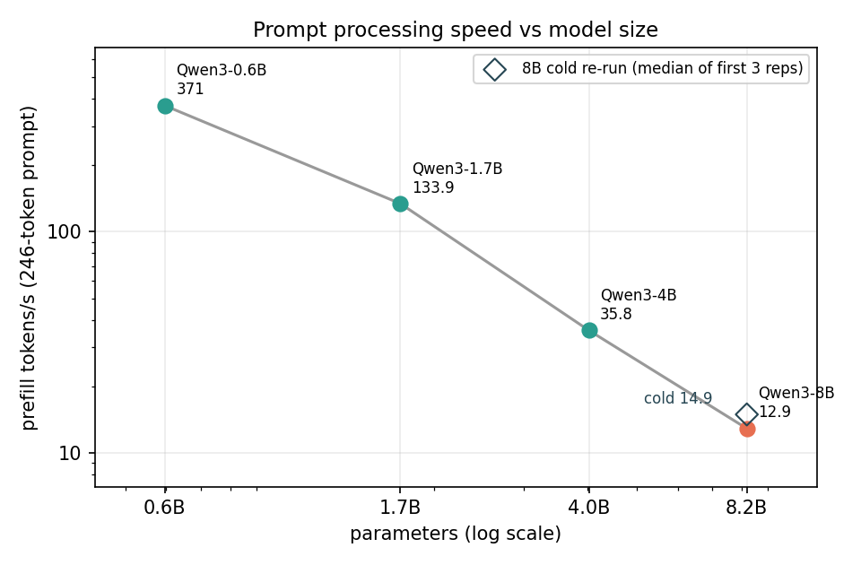
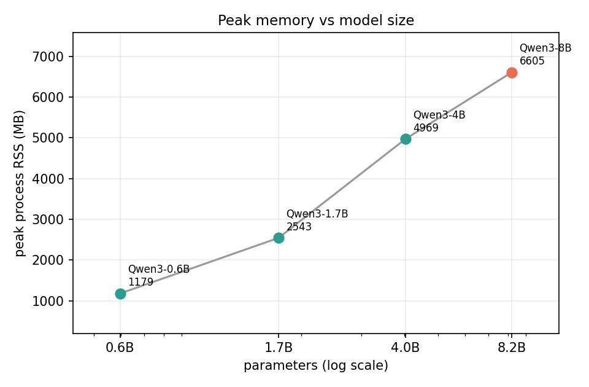
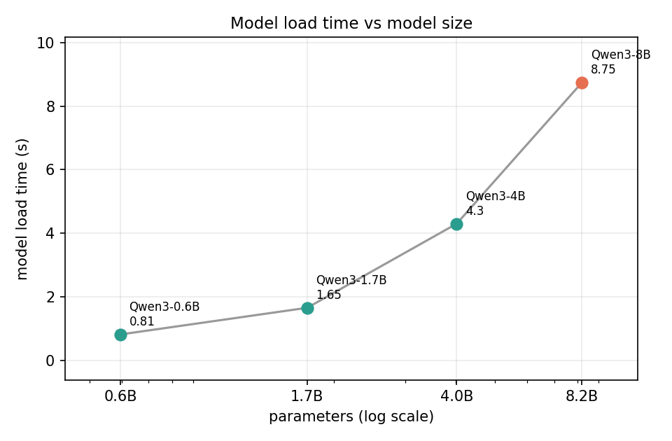
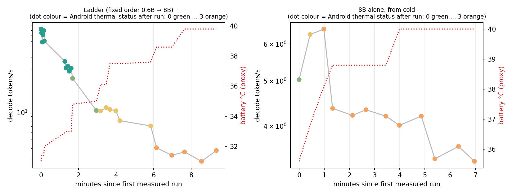

# Project 18 — How big an LLM can a phone run before it stops being interactive?

*30 projects in 30 days · #18 · Android · llama.cpp · NDK · on-device inference*

A small Android app runs GGUF language models **entirely on the phone's ARM64 CPU**, using
[llama.cpp](https://github.com/ggml-org/llama.cpp) through JNI. It also benchmarks a ladder of model sizes
to find where **"fits in memory" ≠ "runs" ≠ "pleasant to use"**.

No cloud, no PC inference, no GPU. Once a model is on the phone, it works in airplane mode with the
cable unplugged. The app does not even declare the `INTERNET` permission.

> **Status (2026-10-06): complete (CPU experiment).** The app works and offline use is verified. The thread
> sweep, the 4-rung ladder and a cold 8B control run have been measured on the device.

## The answer

| Question | Answer (Galaxy Z Fold6, 12 GB) |
|---|---|
| Largest model that **fits** | **Qwen3-8B Q4_K_M** (5.0 GB file, 5.2–6.6 GB peak RSS). It loads and finishes every generation. Nothing larger was tested. |
| Largest model that **runs reliably** | **Qwen3-8B**: 19 measured generations (ladder + cold run) with 0 crashes, 0 OOM and 0 low-memory kills. Reliability is not the limit; speed is. |
| Largest model that is **practically interactive** | **Qwen3-4B**: 10.4 tok/s decode and 0.6 s to the first token for a chat prompt. It sits right on the 10 tok/s line. The 8B fails USABLE even from cold: 4.7 tok/s, and an 18 s first token for a long prompt. |
| How fast does it degrade? | Roughly in proportion to size. Each doubling of parameters costs about 2.4–3× decode speed and 2.7–3.7× prefill speed. |
| Memory or compute first? | **Compute/thermals first.** The 8B ran with about 2 GB still available and almost no swap. It got slower because the CPU throttled, not because the system ran out of RAM. |
| Thermal throttling? | **Yes, strongly.** About 1–2 minutes of 8B generation drives Android's thermal status to 3 (severe) and caps the big cores at about 1.0 GHz instead of 3.1 GHz. Decode drops from about 6.4 to about 3.5 tok/s. |

**In one line:** on a 2024 flagship phone, a 4B model is the practical ceiling for comfortable on-device
chat. An 8B model fits and runs, but is not pleasant to use.

---

## Headline result (Samsung Galaxy Z Fold6, Snapdragon 8 Gen 3, 12 GB)

Qwen3 instruct models, all Q4_K_M from the same source, 6 threads, 128 generated tokens, greedy,
n_ctx 2048, 1 warm-up + 3 repetitions × 2 prompts. Values are medians.

| Model | File | Load | Decode | Prefill (246-tok prompt) | First token: short / long prompt | Peak RSS | Level* |
|---|---|---|---|---|---|---|---|
| Qwen3-0.6B | 0.40 GB | 0.8 s | **73 tok/s** | 371 tok/s | 0.07 s / 0.7 s | 1.2 GB | INTERACTIVE |
| Qwen3-1.7B | 1.11 GB | 1.7 s | **31 tok/s** | 134 tok/s | 0.19 s / 1.8 s | 2.5 GB | INTERACTIVE |
| Qwen3-4B | 2.50 GB | 4.3 s | **10.4 tok/s** | 36 tok/s | 0.6 s / 6.9 s | 5.0 GB | INTERACTIVE (barely) |
| Qwen3-8B (in ladder, hot) | 5.03 GB | 8.8 s | 3.7 tok/s | 13 tok/s | 2.9 s / 19 s | 6.6 GB | FITS |
| **Qwen3-8B (cold control)** | 5.03 GB | 11.0 s | **4.7 tok/s** (peak 6.5) | 14 tok/s | 1.2 s / 18 s | 5.2 GB | **FITS** |

\* Levels from [docs/criteria.md](docs/criteria.md). The thresholds were fixed **before** the ladder was measured:

- **FITS**: loads and completes a generation.
- **USABLE**: no crash, decode ≥ 5 tok/s, and the first token for a long prompt arrives in ≤ 10 s.
- **INTERACTIVE**: usable, plus decode ≥ 10 tok/s and the first token for a short chat prompt in ≤ 2 s.

**Why the 8B has two rows.** The ladder always runs smallest → largest, so the 8B started with the phone
already hot (thermal status 3, big cores capped near 1 GHz). To avoid penalising it unfairly, it was re-run
alone from a cold start (thermal status 0, battery 33 °C). Its classification uses the median of the first 3
repetitions, a rule written down before the run ([criteria addendum](docs/criteria.md)). Even cold, it peaks at
6.5 tok/s, reaches thermal status 3 within about 1.5 minutes and settles at about 4 tok/s. Its median is
**4.7 tok/s, below the 5 tok/s USABLE line**. Its long-prompt first token (18 s) fails USABLE on its own too.

### What the data shows

- **All four rungs fit.** Even the 8B (5 GB file, 6.6 GB peak RSS) loaded and ran with no OOM or
  low-memory kill on a phone that shows only about 3–4 GB "available" when idle.
- **"Fits" is not "pleasant".** Decode speed falls roughly in proportion to model size. That matches
  memory-bandwidth-bound generation: every token reads the whole model, about 26–34 GB/s effective here.
  4B sits right at the 10 tok/s line, and its long-prompt first token already takes about 7 s.
- **Prefill is the hidden cost.** It falls even faster than decode: from 371 to 13 tok/s. Pasting a
  paragraph into the 8B means a 19 s wait before the first word.
- **Thermals are part of the answer.** A phone cannot hold its burst speed. Under sustained 8B load the
  big cores drop from 3.1 to about 1.0 GHz within about 2 minutes, and decode settles at about 3.5–4 tok/s
  (figure 5). The 4B also reached thermal status 2 during the ladder.
- **RAM is not the binding constraint on 12 GB.** llama.cpp repacks Q4_K weights for the i8mm kernels into
  anonymous memory, so resident memory is about the model size plus KV cache. That is about 4.8 GB for the
  8B, and Android still reported about 2 GB available during the runs.

### Figures

| | |
|---|---|
|  |  |
|  |  |



---

## Thread count

A sweep on the two small models picked the thread count, which was then frozen for all rungs.
Data: `results/threads-1-summary.csv`.

| Threads | 0.6B decode | 1.7B decode |
|---|---|---|
| 2 | 46 tok/s | 17 tok/s |
| 4 | 67 | 20 |
| **6** | **78** | **24** |
| 8 | 53 | 17 |

Six threads produced the best throughput on this heterogeneous 1+5+2 CPU (1× Cortex-X4, 5× Cortex-A720,
2× Cortex-A520). Moving to eight threads reduced performance, consistent with the two efficiency cores joining
the workload and/or additional scheduling/synchronization overhead.

## Offline verification

Roman ran a generation in airplane mode with the USB cable unplugged (battery power, no adb, no PC
process): 256 tokens at 61 tok/s. The app's manifest requests only `ACCESS_NETWORK_STATE`, and
`dumpsys package` confirms it. Details: [docs/offline-verification.md](docs/offline-verification.md).

---

## Architecture

```
Kotlin UI (MainActivity, no AndroidX)          app/src/main/java/dev/rq/llmceiling/
   │  BenchRunner · DeviceProbe · ResultStore (JSONL, crash-safe)
  JNI  (llm_jni.cpp)                           app/src/main/cpp/
   │
engine.cpp: instrumented wrapper over the llama.cpp C API
   │  load/prefill/decode timing · /proc/self/status RSS · stop · UTF-8-safe streaming
llama.cpp b11440 (git submodule, unmodified)   third_party/llama.cpp
   │  CPU backend variants (armv8.0 … armv9.2) chosen at runtime · KleidiAI · OpenMP
GGUF on /sdcard/Android/data/dev.rq.llmceiling/files/models  →  ARM64 CPU
```

The integration follows llama.cpp's own `examples/llama.android` (CMake `add_subdirectory`, CPU only, backend
variants loaded with `ggml_backend_load_all_from_path(nativeLibraryDir)`). The project's code wraps it and
does not modify it.

## What gets recorded

Every load, warm-up, run and cooldown is appended right away as one JSON line, so a run killed by the
low-memory killer still leaves evidence. An "inflight" marker records what was running when a process
died. Each run records:

- **Model:** name, architecture, quantization, parameter count, file size.
- **Load:** load time, context creation time, RSS and anonymous/file-backed RSS before and after.
- **Prefill / decode:** token counts, elapsed time, tok/s, time to first token, plus llama.cpp's own perf
  counters as a cross-check.
- **Device state before and after each run:** battery level, temperature and voltage, `plugged`, Android
  thermal status and headroom, current CPU frequencies, system available memory, network state, airplane mode.
- **Settings:** threads, n_ctx, n_batch, n_predict, sampling, seed.

Energy is **not** measured. Android exposes only instantaneous current/voltage and battery temperature,
which are recorded and labelled as proxies.

---

## Reproduce

Requirements (all were already on the machine; nothing was installed): Android SDK, NDK 27.2.12479018,
CMake 3.22.1 from the SDK, JDK 21, adb. The Gradle wrapper is included. llama.cpp's Android sample pins
NDK 29 / CMake 3.31, but the older ones work.

```powershell
git submodule update --init                                         # llama.cpp b11440
powershell -File tools\get-models.ps1 -Sizes 0.6B,1.7B,4B,8B        # resumable; writes models\SHA256SUMS.tsv
powershell -File tools\build.ps1                                    # APK + JVM unit tests
adb install -r app\build\outputs\apk\debug\app-debug.apk
adb push models\Qwen3-0.6B-Q4_K_M.gguf /sdcard/Android/data/dev.rq.llmceiling/files/models/
```

Benchmark (all inference still on the phone; adb only starts it and copies results back):

```powershell
py bench\make_configs.py ladder --threads 6                          # or: threads
adb push bench\ladder.json /sdcard/Android/data/dev.rq.llmceiling/files/bench-config.json
adb shell am start -n dev.rq.llmceiling/.MainActivity --ez bench true
adb pull /sdcard/Android/data/dev.rq.llmceiling/files/results/ladder-1.jsonl results\raw\ladder-1\
py tools\analyze.py results\raw\ladder-1\ladder-1.jsonl                # -> results\ladder-1-{runs,summary}.csv
py tools\figures.py                                                  # needs matplotlib
```

Interactive use: open **LLM Ceiling**, pick a model, then **Load** → type a prompt → **Generate** (and **Stop**).
Qwen3 thinks out loud in a `<think>` block first. Add `/no_think` to a prompt to get a direct answer.

## Repository layout

```
app/                 Android app (Kotlin UI, JNI, instrumented C++ engine, unit tests)
bench/               prompts.json, config generator, generated bench configs
docs/                phase0-environment.md, criteria.md, offline-verification.md
results/             benchmark.csv (all 84 measured runs), *-runs.csv, *-summary.csv (per model), figures/
results/raw/         untouched evidence: device JSONL, logcat, build logs, inventory, model hashes
tools/               build.ps1, get-models.ps1, analyze.py, Phase 0 inventory scripts
third_party/llama.cpp  submodule, unmodified
```

Models are not committed (`*.gguf` is ignored). `results/raw/model-hashes.txt` shows that each local
SHA256 matches the Hugging Face etag for `unsloth/Qwen3-{0.6B,1.7B,4B,8B}-GGUF`.

## Limitations

- **One phone, one model family, one quantization.** The 12 GB Fold6 with Snapdragon 8 Gen 3 is a 2024
  flagship, not an average phone.
- **The phone was on USB during the benchmarks** so results could be pulled back, and charging adds heat.
  The `plugged` state is recorded on every run.
- **Fixed run order** (small → large) confounds model size with heat. The cold 8B re-run addresses the
  worst case. The 4B was not re-run cold, so its 10.4 tok/s is if anything slightly pessimistic.
- **Single session per condition.** Run-to-run spread is in the CSVs (min/max per model), but there are no
  repeated sessions on different days.
- **128-token generations** measure short chat turns, not sustained long-form generation.
- **CPU only, by design.** Vulkan/OpenCL would be a separate, future experiment.
